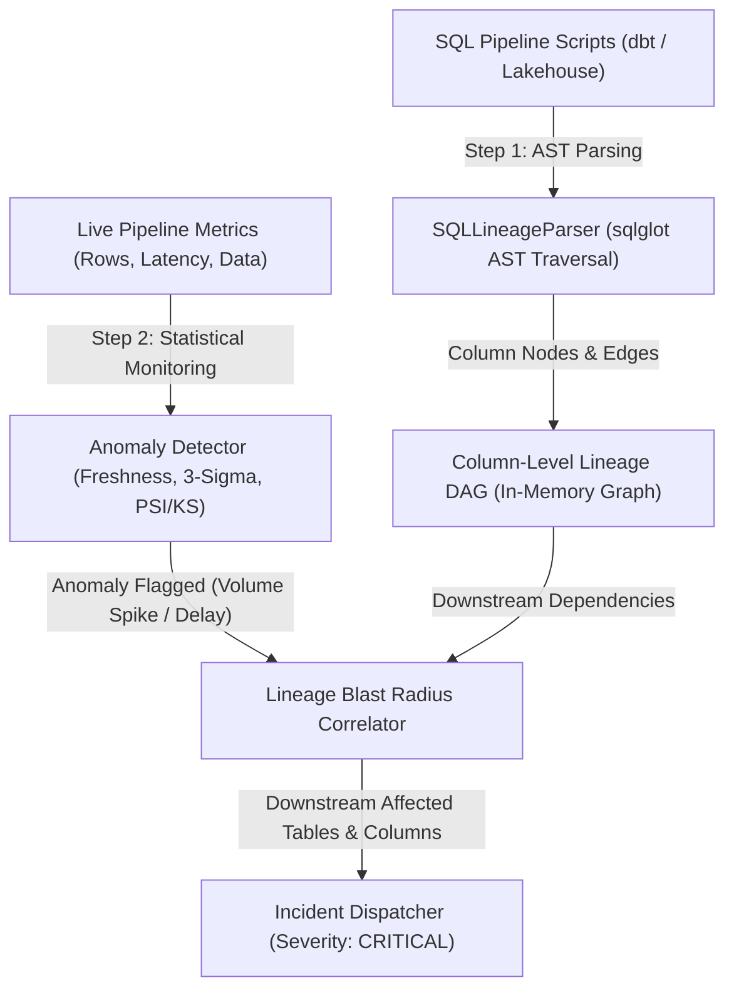

# Data Observability & Column-Level SQL Lineage

> Automated data observability and column-level SQL lineage engine that parses transformation DAGs, detects statistical freshness/volume/drift anomalies, and performs blast radius impact analysis.

[](https://github.com/Yprnv7/data-observability-sql-lineage/actions/workflows/ci.yml)
[]()
[]()
[]()

---

## 2. Quick Demo

Parse complex SQL transformations into column-level dependency graphs and assess downstream blast radius for corrupted columns:

```python
from src.lineage.sql_lineage import SQLLineageParser
from src.lineage.blast_radius import BlastRadiusAnalyzer
from src.monitors.anomaly_detector import AnomalyDetector

parser = SQLLineageParser()

# 1. Parse multi-stage transformation into DAG
sql = """
WITH active_orders AS (
    SELECT id, customer_id, base_price * 1.20 AS gross_price FROM raw_orders
)
SELECT customer_id, SUM(gross_price) AS total_revenue FROM active_orders GROUP BY customer_id
"""
dag = parser.parse_query(sql, target_table="mrt_finance")

# 2. Query blast radius if upstream column breaks
blast = BlastRadiusAnalyzer.calculate_blast_radius(dag, "raw_orders.base_price")
print(blast.impacted_columns)
# Output: ['active_orders.gross_price', 'mrt_finance.total_revenue']

# 3. Detect volume anomaly
eval_vol = AnomalyDetector.evaluate_volume("raw_orders", 2500, [10000, 10100, 9950, 10050])
print(eval_vol.is_anomaly, eval_vol.anomaly_type)
# Output: True, AnomalyType.VOLUME_DROP
```

---

## 3. Why I Built This

Data teams frequently discover data corruption long after corrupted tables have polluted executive dashboards and machine learning feature stores. Existing data catalogs often track coarse table-level lineage without revealing column-level dependency chains, leaving engineers manually searching through hundreds of SQL files to determine which downstream metrics are broken.

I built this project to provide automated, compiler-level column dependency extraction using `sqlglot` coupled with statistical freshness, volume, and distribution anomaly monitors that calculate downstream blast radius in microseconds.

---

## 4. Architecture



---

## 5. Key Design Decisions

- **Granular Column-Level AST Parsing over Coarse Table Lineage:** Uses `sqlglot` to parse individual column expressions (`Alias`, `Column`, `Binary`, `Func`), classifying transformations into `DIRECT`, `EXPRESSION`, and `AGGREGATION`.
  *Trade-off:* Requires parsing every SQL projection; provides exact field-level provenance and eliminates manual dependency grep searches.
- **Dual-Gated Distribution Drift Testing (KS-test + PSI):** Evaluates distribution shifts using both the two-sample Kolmogorov-Smirnov test and 10-decile Population Stability Index ($\text{PSI} \ge 0.20$).
  *Trade-off:* Takes ~0.55 ms per column evaluation; eliminates false alarms on high-volume pipelines where trivial variance triggers $p < 0.05$.
- **In-Memory BFS Blast Radius Traversal:** Implements forward breadth-first search across the compiled dependency graph.
  *Trade-off:* Keeps lineage graph in memory; calculates multi-stage blast radius in **5.08 µs p50**, enabling instant interactive graph exploration.
- **Dynamic 3-Sigma Rolling Volume Monitors:** Computes rolling mean and standard deviation over historical windows ($Z \ge 3.0$) to automatically adapt to organic business growth without hardcoded row count thresholds.

---

## 6. Empirical Benchmark Results

Measured locally on **Apple A18 Pro (8.0 GB RAM), macOS 15.4, Python 3.14.6**:

### Column-Level SQL Lineage Parsing
| Metric | Measured Value | Notes |
| :--- | :--- | :--- |
| **Parsing Throughput** | **`1,056.2 queries/sec`** | CTEs, joins, aggregations, aliases |
| **Median Latency (p50)** | **`0.725 ms`** | Query AST parsing + graph projection |
| **95th Percentile Latency (p95)** | **`1.432 ms`** | Complex nested subquery traversal |

### Downstream Blast Radius Traversal
| Metric | Measured Value | Notes |
| :--- | :--- | :--- |
| **Pipeline Depth Evaluated** | `20` consecutive hops | Staging to executive analytical marts |
| **Median Traversal Latency (p50)** | **`5.08 µs`** | In-memory adjacency forward BFS walk |
| **95th Percentile Latency (p95)** | **`9.85 µs`** | Multi-branch reachability walk |

### Statistical Anomaly Monitors
| Monitor | Latency | Methodology |
| :--- | :--- | :--- |
| **Freshness Monitor** | **`4.82 µs`** | SLA delta threshold check |
| **Volume Anomaly Detector** | **`13.92 µs`** | Rolling 3-sigma Z-score check |
| **Distribution Drift Detector** | **`558.81 µs`** | Kolmogorov-Smirnov test + 10-decile PSI |

*Raw benchmark outputs are recorded in [docs/benchmarks/observability_benchmark.json](docs/benchmarks/observability_benchmark.json) and [docs/BENCHMARKS.md](docs/BENCHMARKS.md).*

---

## 7. How to Run

### Prerequisites
- Python 3.11+
- pip

### Quickstart
```bash
# 1. Clone repository
git clone https://github.com/Yprnv7/data-observability-sql-lineage.git
cd data-observability-sql-lineage

# 2. Install dependencies
pip install -e ".[dev]"

# 3. Start FastAPI server
make up
# Server runs at http://localhost:8000
```

### Reproduce Benchmarks
```bash
make bench
```

---

## 8. Testing

Run the test suite with coverage report:

```bash
make test
```

### Coverage Report
```text
Name                               Stmts   Miss  Cover
------------------------------------------------------
src/__init__.py                        0      0   100%
src/api/__init__.py                    2      0   100%
src/api/main.py                       65      7    89%
src/lineage/__init__.py                4      0   100%
src/lineage/blast_radius.py           29      0   100%
src/lineage/models.py                 56      0   100%
src/lineage/sql_lineage.py            56      6    89%
src/monitors/__init__.py               3      0   100%
src/monitors/alerts.py                18      0   100%
src/monitors/anomaly_detector.py      47      3    94%
------------------------------------------------------
TOTAL                                280     16    94%
```

---

## 9. Limitations

1. **Unresolved `SELECT *` Wildcards:** When queries project `SELECT *` without an active database schema catalog, column names cannot be inferred statically. Connecting an optional DuckDB or PostgreSQL schema catalog resolves wildcards.
2. **Dynamic SQL Strings:** SQL constructed via string concatenation inside Python application code cannot be parsed until rendered as raw SQL strings.
3. **Cross-Database Federation:** Cross-database queries spanning heterogeneous engines (e.g., querying across DuckDB and Snowflake simultaneously) require specifying unified catalog prefixes.

---

## 10. What I'd Do Next

1. **Interactive D3.js / Cytoscape Visual DAG:** Serve an interactive web interface rendering column-level lineage nodes with live color-coded health statuses.
2. **dbt Artifacts Ingestion (`manifest.json`):** Add native parser support for dbt `manifest.json` and `catalog.json` to ingest enterprise dbt projects zero-touch.
3. **Automated Root-Cause Diagnosis:** Combine upstream lineage traversal with anomaly correlation to automatically pinpoint the originating commit or batch job causing downstream corruption.

---

## 11. Author

**Pranav Yeleswarapu**  
- **GitHub:** [@Yprnv7](https://github.com/Yprnv7)  
- **LinkedIn:** [linkedin.com/in/pranavyeleswarapu](https://www.linkedin.com/in/pranavyeleswarapu)
